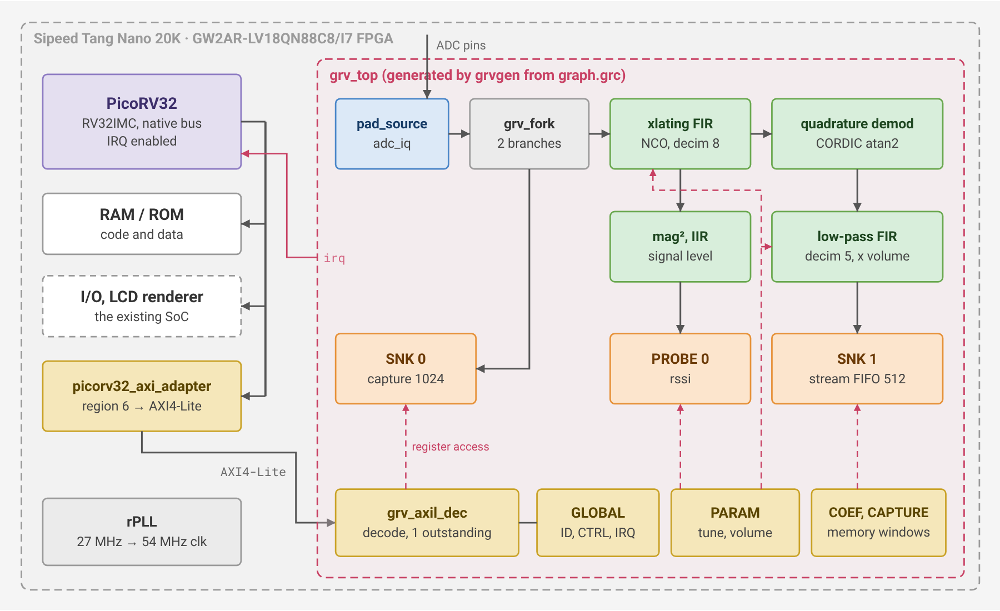
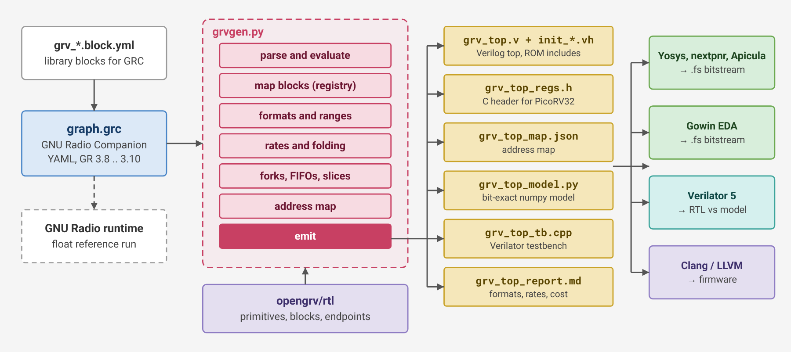
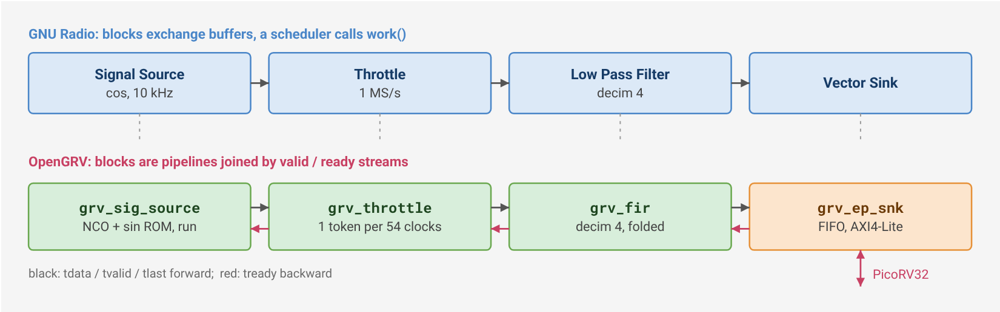
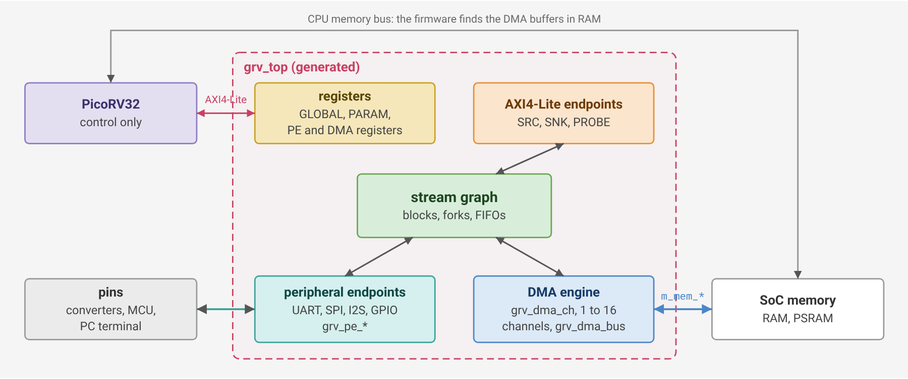
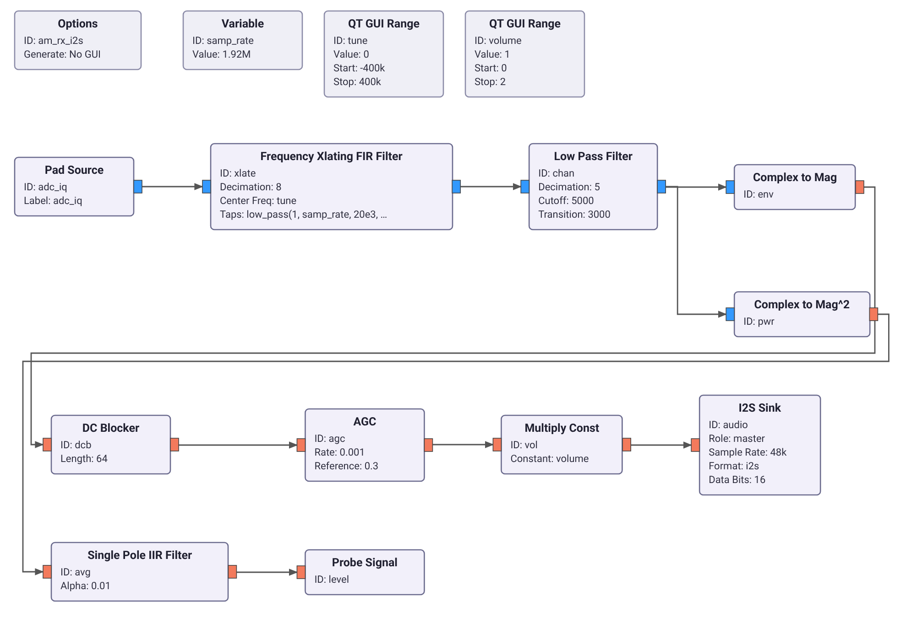
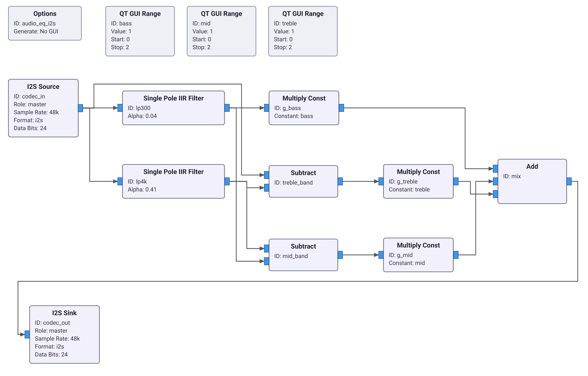
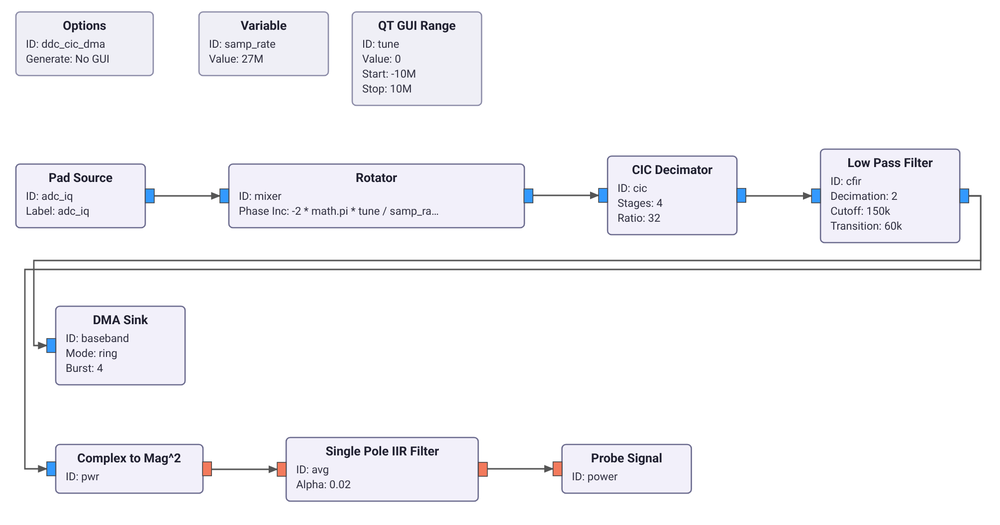
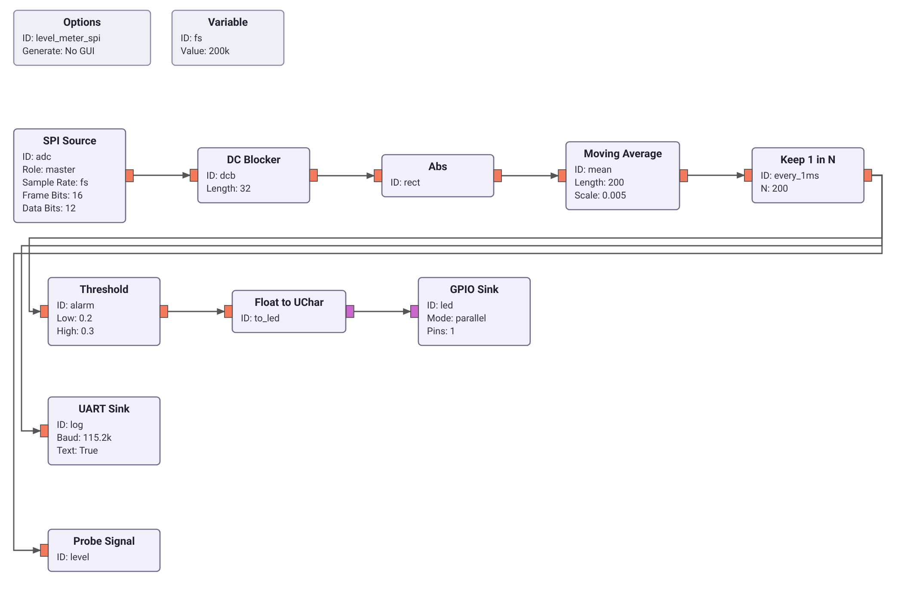
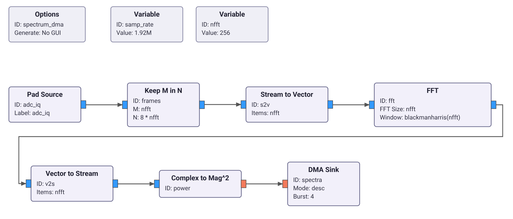

# OpenGRV: GNU Radio flowgraphs in Verilog, by Opus 5.5

OpenGRV is a library of parameterisable GNU Radio blocks written in Verilog-2005, plus a graph
compiler, **grvgen**. grvgen reads a GNU Radio Companion flowgraph (`.grc`) and writes the
top-level module that connects the blocks. The design is described in
`doc/OpenGRV_Design_and_Architecture.pdf`.

- **Data types:** integer and fixed-point only (`sW.F`, `uW.F`, real or complex). grvgen
  chooses every format from the range analysis of the graph and the width profile.
- **Streams:** AXI4-Stream (`tdata`, `tvalid`, `tready`, `tlast`) with full back-pressure.
  Blocks are folded automatically when the sample rate leaves clocks to spare.
- **Graph inputs and outputs:**
  - AXI4-Lite endpoints (FIFOs, capture buffers, probes, runtime parameters) that a CPU such as
    PicoRV32 reads and writes;
  - or top-level AXI4-Stream *pads* for an ADC, a DAC or other logic;
  - or **peripheral endpoints** that stream through FPGA pins (UART, SPI master or slave, I2S for
    audio codecs, GPIO as parallel words, PWM or sigma-delta) and **DMA channels** that move
    samples between the graph and memory without the CPU.
- **Bit-exact Python model of every block.** grvgen composes them into a model of the whole
  graph. That model checks the hardware in simulation and the graph against floating-point
  GNU Radio.

```
grvgen/grvgen.py        the compiler (Python 3, PyYAML, NumPy)
grvgen/grv/             core (passes), blocks and periph (GRC mappers), emit*, tb_pe, models, fx, firdes, expr
rtl/prim                handshake and arithmetic primitives (skid, FIFO, fork, resize, CORDIC, sine)
rtl/blocks              43 block modules
rtl/axil                AXI4-Lite control plane: decoder, global registers, endpoints, probes
rtl/periph              peripheral endpoints: UART, SPI (master and slave), I2S, GPIO, and their common parts
rtl/dma                 DMA channel, bus master, CPU/DMA arbiter, native-to-AXI4-Lite bridge
rtl/inc                 generated tables (CORDIC angles)
fw/grv.h                register map common to all graphs; fw/grv_dma.h: DMA helpers; fw/examples: firmware
grc/                    GRC block definitions of the OpenGRV-specific blocks (AXI4-Lite endpoints, CIC, quantize,
                        UART, SPI, I2S, GPIO and DMA sources and sinks)
examples/               12 example designs with flowgraph, picture, README and generated files (examples/README.md)
tools/                  example generator and runner, flowgraph renderer (grc2svg.py), lint, synthesis
tb/unit                 unit tests: each module in Icarus with random handshakes vs. its model
tb/pe                   unit tests of the peripheral endpoints and the DMA (pin and memory models in Verilog)
tb/axil                 control-plane testbench
tb/graph                graph tests: GRC -> grvgen -> Verilator testbench vs. graph model; diagnostics tests
tools                   lint.sh, synth.sh (Gowin with Yosys), gen_sin_tab.py
```

## How it works

The design document (`doc/OpenGRV_Design_and_Architecture.pdf`) explains every part in detail;
these four figures from it give the big picture.

grvgen turns a flowgraph into one generated module, `grv_top`, that sits next to the CPU in the
FPGA. Samples flow through the blocks as AXI4-Streams; the CPU never touches them on their way. It
starts and stops the graph, retunes it and reads results through AXI4-Lite registers.


*An OpenGRV system on the Tang Nano 20K. Solid arrows are streams; dashed arrows are register accesses.*

From one `.grc` file, grvgen writes the Verilog top level, the C header for the firmware, a
Verilator testbench and a bit-exact model of the graph. Only the top level is generated: the
blocks, the primitives and the control plane are fixed library modules.


*Design flow: from the GNU Radio Companion file to the bitstream, the testbench and the firmware.*

Each GRC block becomes a module instance and each connection a stream with full back-pressure.
grvgen chooses a fixed-point format for every stream from a range analysis, folds blocks onto
fewer multipliers when the sample rate leaves clocks to spare, and adds what the hardware needs
and GNU Radio does not: forks where one output feeds several inputs, balancing FIFOs on paths that
meet again, and endpoints where the graph meets the CPU.


*The same graph in GNU Radio (top) and in OpenGRV (bottom).*

Peripheral endpoints connect a graph straight to FPGA pins (UART, SPI, I2S, GPIO) and DMA channels
connect it to memory, so samples can enter and leave without the CPU, which only configures them
and handles interrupts.


*Peripheral endpoints at the pins and the DMA engine at the memory; the CPU keeps the control path.*

## Examples

`examples/` holds twelve designs. Each has its GNU Radio Companion flowgraph, a picture of it, a
README with its interfaces, runtime parameters and resource estimate, and the files grvgen
generates. `python3 tools/run_examples.py` generates all of them and simulates each against its
bit-exact model, with device models at the pins (`-k NAME` for one).

| Example | What it is |
|---|---|
| [nbfm_rx](examples/nbfm_rx/nbfm_rx.grc) | NBFM receiver, the worked example of the design document |
| [nbfm_rx_pe](examples/nbfm_rx_pe/nbfm_rx_pe.grc) | The same receiver with a sigma-delta audio pin, a DMA snapshot and a UART log |
| [am_rx_i2s](examples/am_rx_i2s/README.md) | AM receiver with I2S audio and a level probe |
| [wbfm_rx_i2s](examples/wbfm_rx_i2s/README.md) | Wideband FM receiver from primitive blocks, I2S audio |
| [qpsk_tx_spi](examples/qpsk_tx_spi/README.md) | QPSK modulator with RRC shaping to a dual SPI DAC |
| [bpsk_rx_uart](examples/bpsk_rx_uart/README.md) | BPSK receiver with Costas loop, bytes out on a UART |
| [spectrum_dma](examples/spectrum_dma/README.md) | 256-point spectrum analyser, spectra to RAM by DMA descriptors |
| [audio_eq_i2s](examples/audio_eq_i2s/README.md) | Stereo three-band equaliser between I2S codecs |
| [dtmf_gen](examples/dtmf_gen/README.md) | DTMF generator on a sigma-delta pin and I2S |
| [ddc_cic_dma](examples/ddc_cic_dma/README.md) | Digital down-converter at 27 MS/s: rotator, CIC, FIR, DMA ring |
| [level_meter_spi](examples/level_meter_spi/README.md) | Level meter: SPI ADC, alarm LED, UART text log, probe |
| [siggen_spi_dac](examples/siggen_spi_dac/README.md) | Quadrature signal generator on a dual SPI DAC, sawtooth on a PWM pin |

Five of them:

**AM receiver** (`am_rx_i2s`): two-stage channel filter, envelope detector, AGC and an I2S DAC.



**Stereo equaliser** (`audio_eq_i2s`): the stereo pair travels as one complex stream between two
I2S codecs; three bands with runtime gains.



**Digital down-converter** (`ddc_cic_dma`): 27 MS/s in, a four-stage CIC and a compensating FIR,
the baseband written to a ring buffer in RAM.



**Level meter** (`level_meter_spi`): an SPI ADC in, and three peripheral outputs at 1 kS/s.



**Spectrum analyser** (`spectrum_dma`): one frame in eight through a windowed FFT, each power
spectrum into its own buffer by DMA descriptors.



## Quick start

```sh
python3 grvgen/grvgen.py examples/nbfm_rx/nbfm_rx.grc -o build/nbfm
```

This writes, into `build/nbfm`:

| File | Contents |
|---|---|
| `nbfm_rx_top.v` | the top level |
| `nbfm_rx_top.f` | the file list |
| `nbfm_rx_top_regs.h` | the C header |
| `nbfm_rx_top_map.json` | the address map |
| `nbfm_rx_top_model.py` | the bit-exact model |
| `nbfm_rx_top_tb.cpp`, `nbfm_rx_top_tbvec.py`, `nbfm_rx_top_sim.sh` | the Verilator testbench |
| `nbfm_rx_top_report.md` | formats, rates, folding, filters, addresses and estimates |

Run the generated testbench. It drives the pads, the AXI4-Lite bus and the runtime parameters,
then compares every output sample with the model:

```sh
build/nbfm/nbfm_rx_top_sim.sh -n 8192 --param tune=100e3 --param volume=0.7
```

`make test` runs everything: unit tests, the peripheral and DMA tests, the control plane, graph
tests, diagnostics, all examples and lint. `make synth` synthesises the example for Gowin.

### Peripheral endpoints and DMA

Ten GRC blocks (`grv_uart_source`/`_sink`, `grv_spi_source`/`_sink`, `grv_i2s_source`/`_sink`,
`grv_gpio_source`/`_sink`, `grv_dma_source`/`_sink`) carry the settings of an endpoint; grvgen turns
them into module parameters and register reset values, so the graph runs without any setup beyond
`RUN`. A standard file, ZeroMQ, network, audio or vector block maps to one of them with a pragma in
its comment, e.g. `@grv via=uart baud=921600 text` or `@grv via=i2s samp_rate=48e3` (its other GRC
parameters are ignored). For these graphs grvgen also:

- adds the pins to the top level as `<block>_<pin>` (`log_txd`, `adc_sclk`, `audio_out`, ...) and,
  with DMA blocks, the PicoRV32-style memory port `m_mem_*`;
- writes `<top>_pins.cst`, a Gowin constraint template (`--emit pins`, included in `--emit all`);
- puts the endpoint and channel offsets, their `IRQ2_STATUS` bits and the computed `TIMING`,
  `FORMAT` and `CMD` values into the header; `--dma-window LO:HI` sets the reset value of the DMA
  address window;
- checks rates and timing: E602 (SPI transfer longer than the sample period), E603 (more than 16
  endpoints or channels), E604 (pin name collision), E605 .. E610 (UART bit time, field widths,
  missing sample rate, DMA alignment, unknown `via`, I2S bit clock above clk/8), W601 (UART slower
  than its stream), W602 (pace and stream rate differ), W603 and W605 (slave clock, MCLK accuracy).

I2S endpoints are masters (they drive `bclk`, `ws` and optionally `mclk`) or slaves; a complex stream
is stereo (I = left, Q = right), a real stream one channel; Philips, left- and right-justified
formats with 16- to 32-bit words in 16- to 32-bit slots.

The generated testbench replaces each endpoint by a model at its pins (a UART line, an SPI converter
or SPI master, an I2S codec, GPIO drivers and monitors) and the memory port by a memory with random latency
(`grvgen/grv/tb/grv_bfm.h`), and compares with the graph model as before.

```sh
python3 grvgen/grvgen.py examples/nbfm_rx_pe/nbfm_rx_pe.grc -o build/nbfm_pe
build/nbfm_pe/nbfm_rx_top_sim.sh -n 20000 --param tune=100e3
```

`fw/examples/nbfm_rx_pe.c` asks for spectrum snapshots with `grv_dma_single()` and gets an
interrupt when they are in RAM; the audio and the log need no code.

Firmware includes `fw/grv.h` and the generated header. `fw/examples/nbfm_rx.c` does the following:

- starts the receiver;
- tunes it with integer arithmetic only;
- drains the audio FIFO in its interrupt handler;
- takes a spectrum capture and reads the RSSI probe.

## Status

All of the following pass:

| Test | Result |
|---|---|
| Unit tests (`tb/unit`) | 188 randomised runs over all 43 blocks and the primitives. Every output sample equals the model with random `tvalid` and `tready`. |
| Peripheral endpoints and DMA (`tb/pe/run_pe.py`) | 319 runs: I2S 36 (master and slave both ways, three formats, 16 to 32 bits, mono and stereo, channel select, duplication, inverted ws, fractional bit clocks, decoded by an independent frame monitor), UART 61 (parities, stop bits, byte order, inversion, flow control, text, framing by gap and count, errors), SPI 70 (all four modes, LSB first, offset binary, command words, chip-select timing, master and slave back to back, real and complex), GPIO 62 (periodic with clock output, strobe, on change, parallel, PWM, first- and second-order sigma-delta bit-exact against a reference), DMA 90 (single, descriptors with OWN/KICK, rings with and without flow, packets ended by `tlast`, window errors, abort; elements of 1 to 8 bytes; random memory latency and CPU traffic on the arbiter). |
| Control plane (`tb/axil/tb_ctrl.v`) | Decoder, registers, source and sink endpoints (stream and capture), probes, timeouts and responses. |
| Graph tests (`tb/graph/test_graphs.py`) | 16 generated graphs. 10 cover 95 of the 178 supported GRC block ids; most of the others are type-specific aliases and hardware or network endpoints that map to the same modules. They include folded and parallel filters, runtime ranges, choosers and check boxes written over AXI4-Lite. 6 cover the peripheral endpoints and DMA channels in 32 configurations, including `@grv via=`. Hardware equals the graph model through the endpoints, pads, pins and memory. |
| Diagnostics (`tb/graph/test_errors.py`) | 19 cases: E101, E107, E109, E302, E303, E304, E401, E602 .. E610, W601, W602 and W605. |
| NBFM example, hardware | The Verilator run (76 800 ADC samples, tuned to +100 kHz) is bit-exact. |
| NBFM example with endpoints (`make example_pe`) | Sigma-delta audio, DMA snapshot and UART log against the model. |
| Examples (`tools/run_examples.py`) | All ten example designs against their models at the pins and in memory. |
| NBFM example, model vs. float | `examples/nbfm_rx/check_float.py` compares the model with a floating-point NumPy version of the GNU Radio chain: SNR 73 dB, error below 1 LSB of the s16.12 output. |
| Lint (`tools/lint.sh`) | All modules and the generated tops are clean with `verilator -Wall`. Width-extension, unused-signal and style warnings are waived. |

### Resources of the example

These numbers come from `tools/synth.sh` (Yosys `synth_gowin`, GW2A, before place and route):

| Resource | Used | Device (GW2AR-18) |
|---|---|---|
| LUT4 | 3 525 | |
| ALU | 2 453 | |
| Logic in total | about 6 000 | 20 736 |
| Flip-flops | 2 984 | |
| Multipliers | 15 MULT18X18 + 2 MULT9X9 | 48 |
| Block RAM | 11 | 46 |

grvgen's estimate in the report is coarse: about 5 500 logic cells and 14 multipliers.

The largest single item is the 32-bit iterative CORDIC of the quadrature demodulator, about
1 200 LUTs (see the deviations below). Timing at 54 MHz has not been checked with the Gowin
place-and-route tools.

## Deviations from the design document

Revision 0.3 of the document describes the implementation of the peripheral endpoints, I2S and the
DMA. The points below are where the code still differs from the document or where the document
leaves the choice open.

### Not implemented yet

grvgen reports a warning or error for each of these.

- **Separate stream clock:** `--dsp-clk` is not supported. The graph runs on the bus clock.
- **Range and padding options:** `--range rms` and `--pad-bytes` are not supported.
- **Block descriptors:** they are Python mappers in `grvgen/grv/blocks.py`, not YAML files in a
  registry. `--registry` and user modules (`@grv module=`) are not supported yet.
- **Reloadable coefficient banks:** taps that depend on a runtime variable are rejected with
  E401. A runtime parameter must be affine in its variable, or be a chooser.
- **`*_init_*.vh` ROM files:** taps, vectors and tables are passed as packed parameters.
- **Hierarchical blocks:** GRC hier blocks are not expanded.
- **Register slices:** `--slices auto` behaves like `all`.

### Implementation choices

- **FFT:** in-place radix-2 DIF in block RAM with one butterfly, instead of a streaming
  pipeline. It accepts one vector at a time and needs about 3·N·log2 N clocks per vector.
- **Sine table:** quarter wave of 1024 entries, 18 bits (s18.17). Its value at 90° is produced by
  logic.
- **Rounding:** float-to-integer conversions round half to even (ROUND = 3), as `lrintf` does in
  GNU Radio.
- **Quadrature demodulator:** when folded, the conjugate product keeps 32 bits and the CORDIC runs
  24 iterations. At 18 bits the receiver lost about 45 dB of SNR at moderate signal levels.
- **DC blocker:** the long form is implemented as the short form (two moving averages). grvgen
  gives warning W104.
- **Endpoint order:** endpoints are numbered in the alphabetical order of their block names. In
  the example, `audio` is sink 0 (0x2000) and `spectrum` is sink 1 (0x2100, window 0xA000). The
  address-map table in the document lists them the other way round.
- **Join balancing:** balancing FIFOs are inserted from the fill and capacity metadata.
  Multi-rate interleavers are excluded.
  - Two inputs of a join that come from the same source at different rate ratios are rejected
    (E304).
  - Free-running sources joined by blocks with different consumption patterns are the user's
    responsibility, as in GNU Radio.
- **Scramblers:** the multiplicative scrambler follows the GNU Radio LFSR exactly, so the
  descrambled stream lags the input by `len + 1` bits.
- **Stream tags:** only `tlast` is carried. Tag-only blocks are removed with a warning.

### Peripheral endpoints, I2S and DMA

- **DMA structure, FIFO, MM2S completion, SPI slave `drdy`, extra diagnostics:** these differed
  from revision 0.2 of the document; revision 0.3 describes them as implemented (one `grv_dma_ch`
  per channel and a shared `grv_dma_bus`, FIFO depth in samples, `DONE` once the last sample has
  left the FIFO, `drdy` also while a preloaded sample waits, E605 .. E610, W603, W605).
- **I2S slaves** lock on the first ws edge after they are enabled, so the first frame after enable
  is lost; I2S masters start every run with a left channel.
- **Rates:** signal and noise generators stay free-running (no rate unless `@grv rate=`), so W601
  and W602 are given only where the stream rate is known.
- **GPIO widths:** `data_bits = 0` (the default of the GRC blocks) means `pins / components` for
  parallel ports, 8 bits for PWM and 12 bits for sigma-delta; `pins` is checked only where it fixes
  the width.
- **Generated testbench:** the sigma-delta output is checked against the expected samples through
  block means (the modulator itself is checked bit-exactly by `tb/pe`); PWM is checked exactly when
  unpaced (one sample per period); a periodic GPIO input is driven on a schedule centred on its
  sampling instants.
- **Generated testbench, pads:** a pad with a known rate is now fed at that rate (as a converter
  would), so that real-time graphs with paced outputs and DROP see the stream they would see in
  hardware; `+nopace` restores the random handshake of revision 0.1.
- **Testbench GPIO monitor:** a parallel output without pacing is compared as runs of equal
  values, since it only changes with the data.
- **Synthesis:** `examples/nbfm_rx_pe` synthesises (Yosys `synth_gowin`, before place and route) to
  4 392 LUT4, 2 709 ALU, 4 136 flip-flops, 7 block RAMs and the same 15 MULT18X18 + 2 MULT9X9 as the
  receiver of revision 0.1 (3 525 LUT4, 2 453 ALU, 2 984 flip-flops, 11 block RAMs): the three
  endpoints and the DMA channel cost about 900 LUTs and 1 150 flip-flops, and the DMA snapshot frees
  the four block RAMs of the capture buffer and the endpoint FIFOs. Their FIFOs map to LUT RAM.
  Timing has not been checked with the Gowin place-and-route tools.

## Licence

MIT (SPDX identifiers in the sources).
