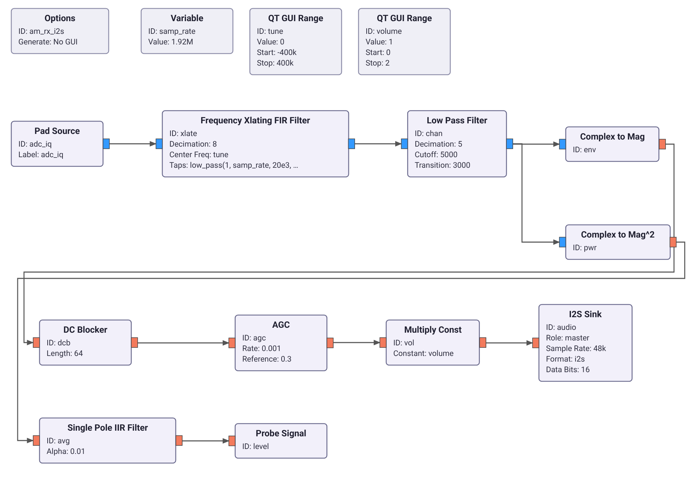

# AM receiver with I2S audio



An AM receiver for a complex ADC at 1.92 MS/s: channel selection with a frequency-translating FIR, a second filter to 48 kS/s, envelope detection, DC removal and AGC; the audio goes to an I2S DAC (both channels) and the CPU reads the signal level from a probe.

## Interfaces

| Interface | Kind | Format and rate | Pins or address |
|---|---|---|---|
| adc_iq | AXI4-Stream pad (in) | cs16.14, 1.92 MS/s | `adc_iq_tdata`, `_tvalid`, `_tready`, `_tlast` |
| audio | I2S output | s16.15, 48 kS/s | `audio_bclk`, `audio_ws`, `audio_sd` (registers at 0x6000) |
| level | probe | s16.9 | register 0x3000 |

## Runtime parameters

| Variable | Range | Default | Register | Block |
|---|---|---|---|---|
| `tune` | -400000 .. 400000 | 0 | 0x0100 | xlate |
| `volume` | 0 .. 2 | 1 | 0x0104 | vol |

Write the hardware value of a parameter with the conversion function of the generated header (`am_rx_i2s_top_<name>_hw()`), then set `CTRL.COMMIT`.

## Resources

grvgen estimate at 54 MHz: about 4061 LUT (1180 in the control plane), 14 multipliers (18x18), 10 block RAMs. The report in `generated/` lists every block, filter and stream.

## Build and simulate

```sh
python3 grvgen/grvgen.py examples/am_rx_i2s/am_rx_i2s.grc -o build/am_rx_i2s
build/am_rx_i2s/am_rx_i2s_top_sim.sh -n 20000 --param tune=50000.0
```

The testbench drives and checks the pins with models of the devices (converters, codecs, a UART line, a memory with random latency) and compares every output with the bit-exact graph model. `python3 tools/run_examples.py -k am_rx_i2s` does both steps.

`generated/` holds the top level, the C header, the report and the pin constraint template as grvgen writes them.
