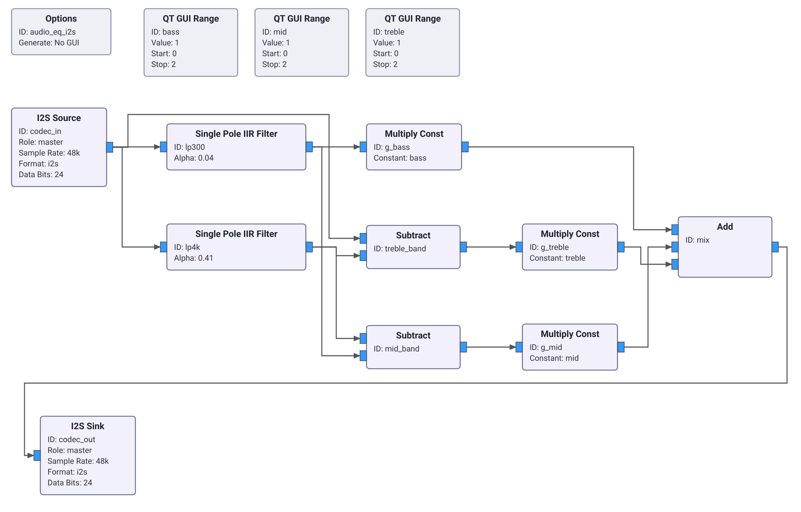

# Stereo three-band equaliser between I2S codecs



A stereo three-band equaliser: the codec ADC delivers left and right as one complex stream, two one-pole low-pass filters split it into bass, mid and treble, each band has a runtime gain, and the sum goes to the codec DAC. Both I2S ports are masters at 48 kHz.

## Interfaces

| Interface | Kind | Format and rate | Pins or address |
|---|---|---|---|
| codec_in | I2S input | cs24.23, 48 kS/s | `codec_in_bclk`, `codec_in_ws`, `codec_in_sd` (registers at 0x6000) |
| codec_out | I2S output | cs24.23, 48 kS/s | `codec_out_bclk`, `codec_out_ws`, `codec_out_sd` (registers at 0x6100) |

## Runtime parameters

| Variable | Range | Default | Register | Block |
|---|---|---|---|---|
| `bass` | 0 .. 2 | 1 | 0x0100 | g_bass |
| `mid` | 0 .. 2 | 1 | 0x0104 | g_mid |
| `treble` | 0 .. 2 | 1 | 0x0108 | g_treble |

Write the hardware value of a parameter with the conversion function of the generated header (`audio_eq_i2s_top_<name>_hw()`), then set `CTRL.COMMIT`.

## Resources

grvgen estimate at 54 MHz: about 2110 LUT (1160 in the control plane), 10 multipliers (18x18), 2 block RAMs. The report in `generated/` lists every block, filter and stream.

## Build and simulate

```sh
python3 grvgen/grvgen.py examples/audio_eq_i2s/audio_eq_i2s.grc -o build/audio_eq_i2s
build/audio_eq_i2s/audio_eq_i2s_top_sim.sh -n 4000 --param bass=1.5 --param treble=0.5
```

The testbench drives and checks the pins with models of the devices (converters, codecs, a UART line, a memory with random latency) and compares every output with the bit-exact graph model. `python3 tools/run_examples.py -k audio_eq_i2s` does both steps.

`generated/` holds the top level, the C header, the report and the pin constraint template as grvgen writes them.
