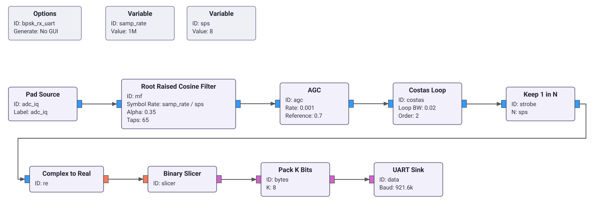

# BPSK receiver with a UART data output



A BPSK receiver for a complex ADC at 1 MS/s and 125 kbit/s: root-raised-cosine matched filter, AGC, Costas loop for the carrier, one sample per symbol, slicer, and bytes out on a UART at 921600 Bd. The symbol clock is assumed known (a fixed phase), as in a lab link.

## Interfaces

| Interface | Kind | Format and rate | Pins or address |
|---|---|---|---|
| adc_iq | AXI4-Stream pad (in) | cs16.14, 1 MS/s | `adc_iq_tdata`, `_tvalid`, `_tready`, `_tlast` |
| data | UART output | u8.0, 15.625 kS/s | `data_txd` (registers at 0x6000) |

## Resources

grvgen estimate at 54 MHz: about 2360 LUT (1120 in the control plane), 12 multipliers (18x18), 4 block RAMs. The report in `generated/` lists every block, filter and stream.

## Build and simulate

```sh
python3 grvgen/grvgen.py examples/bpsk_rx_uart/bpsk_rx_uart.grc -o build/bpsk_rx_uart
build/bpsk_rx_uart/bpsk_rx_uart_top_sim.sh -n 16000
```

The testbench drives and checks the pins with models of the devices (converters, codecs, a UART line, a memory with random latency) and compares every output with the bit-exact graph model. `python3 tools/run_examples.py -k bpsk_rx_uart` does both steps.

`generated/` holds the top level, the C header, the report and the pin constraint template as grvgen writes them.
