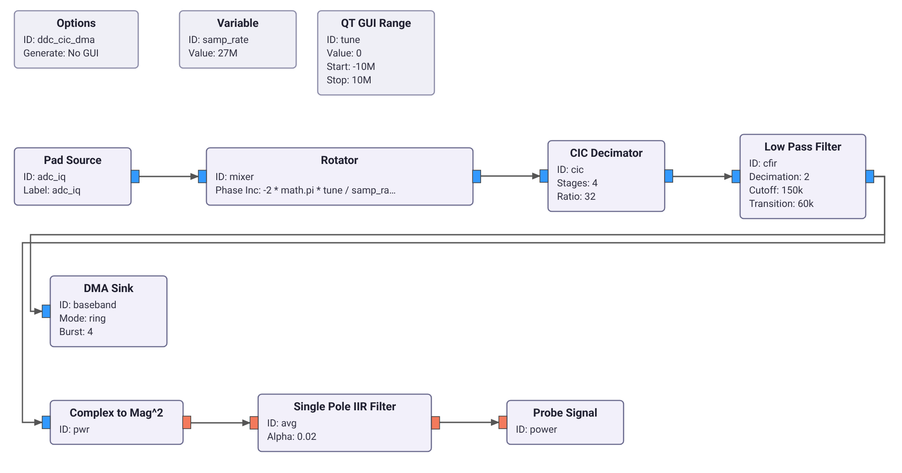

# Digital down-converter with CIC and DMA



A digital down-converter for an ADC at 27 MS/s: a rotator moves the channel to 0 Hz, a four-stage CIC decimates by 32, a compensating FIR by 2 more, and a DMA channel writes the 421.875 kS/s baseband into a ring buffer in RAM. A probe tracks the channel power.

## Interfaces

| Interface | Kind | Format and rate | Pins or address |
|---|---|---|---|
| adc_iq | AXI4-Stream pad (in) | cs16.14, 27 MS/s | `adc_iq_tdata`, `_tvalid`, `_tready`, `_tlast` |
| baseband | DMA channel (S2MM, ring) | cs16.12 in 2-byte containers, 421.875 kS/s | `m_mem_*` (registers at 0x7000) |
| power | probe | s16.9 | register 0x3000 |

## Runtime parameters

| Variable | Range | Default | Register | Block |
|---|---|---|---|---|
| `tune` | -1e+07 .. 1e+07 | 0 | 0x0100 | mixer |

Write the hardware value of a parameter with the conversion function of the generated header (`ddc_cic_dma_top_<name>_hw()`), then set `CTRL.COMMIT`.

## Resources

grvgen estimate at 54 MHz: about 3096 LUT (1410 in the control plane), 9 multipliers (18x18), 3 block RAMs. The report in `generated/` lists every block, filter and stream.

## Build and simulate

```sh
python3 grvgen/grvgen.py examples/ddc_cic_dma/ddc_cic_dma.grc -o build/ddc_cic_dma
build/ddc_cic_dma/ddc_cic_dma_top_sim.sh -n 65536 --param tune=1500000.0
```

The testbench drives and checks the pins with models of the devices (converters, codecs, a UART line, a memory with random latency) and compares every output with the bit-exact graph model. `python3 tools/run_examples.py -k ddc_cic_dma` does both steps.

`generated/` holds the top level, the C header, the report as grvgen writes them.
