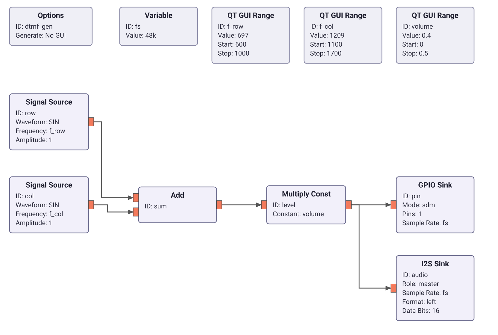

# DTMF generator on a sigma-delta pin and I2S



A DTMF tone generator: two oscillators with runtime frequencies (the row and column tones of a key) are summed and scaled, then played on a single pin as a second-order sigma-delta bit stream (an RC filter makes it analogue) and on an I2S DAC.

## Interfaces

| Interface | Kind | Format and rate | Pins or address |
|---|---|---|---|
| audio | I2S output | s16.15, 48 kS/s | `audio_bclk`, `audio_ws`, `audio_sd` (registers at 0x6000) |
| pin | GPIO output | s12.11, 48 kS/s | `pin_out` (registers at 0x6100) |

## Runtime parameters

| Variable | Range | Default | Register | Block |
|---|---|---|---|---|
| `f_col` | 1100 .. 1700 | 1209 | 0x0100 | col |
| `f_row` | 600 .. 1000 | 697 | 0x0104 | row |
| `volume` | 0 .. 0.5 | 0.4 | 0x0108 | level |

Write the hardware value of a parameter with the conversion function of the generated header (`dtmf_gen_top_<name>_hw()`), then set `CTRL.COMMIT`.

## Resources

grvgen estimate at 54 MHz: about 1788 LUT (1160 in the control plane), 3 multipliers (18x18), 2 block RAMs. The report in `generated/` lists every block, filter and stream.

## Build and simulate

```sh
python3 grvgen/grvgen.py examples/dtmf_gen/dtmf_gen.grc -o build/dtmf_gen
build/dtmf_gen/dtmf_gen_top_sim.sh -n 600 --param f_row=852 --param f_col=1477
```

The testbench drives and checks the pins with models of the devices (converters, codecs, a UART line, a memory with random latency) and compares every output with the bit-exact graph model. `python3 tools/run_examples.py -k dtmf_gen` does both steps.

`generated/` holds the top level, the C header, the report and the pin constraint template as grvgen writes them.
