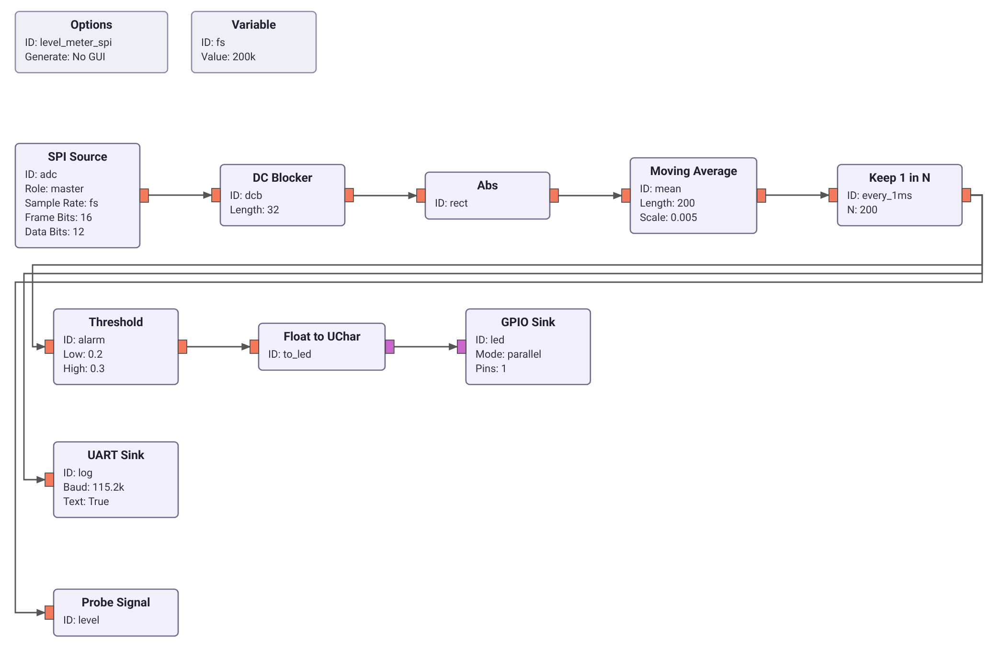

# Level meter: SPI ADC, LED and UART log



An audio level meter: a 12-bit SPI ADC samples at 200 kS/s, DC is removed, the rectified signal is averaged over 1 ms and read 1000 times per second. The level drives an alarm LED through a threshold with hysteresis, is logged as text on a UART and is readable from a probe.

## Interfaces

| Interface | Kind | Format and rate | Pins or address |
|---|---|---|---|
| adc | SPI master input | s12.11, 200 kS/s | `adc_sclk`, `adc_cs_n`, `adc_mosi`, `adc_miso` (registers at 0x6000) |
| led | GPIO output | u1.0, 1 kS/s | `led_out` (registers at 0x6100) |
| log | UART output | s16.14, 1 kS/s | `log_txd` (registers at 0x6200) |
| level | probe | s16.14 | register 0x3000 |

## Resources

grvgen estimate at 54 MHz: about 1848 LUT (1160 in the control plane), 2 multipliers (18x18), 2 block RAMs. The report in `generated/` lists every block, filter and stream.

## Build and simulate

```sh
python3 grvgen/grvgen.py examples/level_meter_spi/level_meter_spi.grc -o build/level_meter_spi
build/level_meter_spi/level_meter_spi_top_sim.sh -n 20000
```

The testbench drives and checks the pins with models of the devices (converters, codecs, a UART line, a memory with random latency) and compares every output with the bit-exact graph model. `python3 tools/run_examples.py -k level_meter_spi` does both steps.

`generated/` holds the top level, the C header, the report and the pin constraint template as grvgen writes them.
