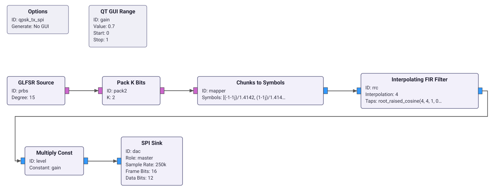

# QPSK transmitter to a dual SPI DAC



A QPSK modulator: a PRBS feeds pairs of bits to the constellation mapper, a root-raised-cosine interpolator shapes the symbols (4 samples per symbol), and a dual 12-bit SPI DAC (I on channel A, Q on channel B) plays them at 250 kS/s.

## Interfaces

| Interface | Kind | Format and rate | Pins or address |
|---|---|---|---|
| dac | SPI master output | cs12.11, 250 kS/s | `dac_sclk`, `dac_cs_n`, `dac_mosi` (registers at 0x6000) |

## Runtime parameters

| Variable | Range | Default | Register | Block |
|---|---|---|---|---|
| `gain` | 0 .. 1 | 0.7 | 0x0100 | level |

Write the hardware value of a parameter with the conversion function of the generated header (`qpsk_tx_spi_top_<name>_hw()`), then set `CTRL.COMMIT`.

## Resources

grvgen estimate at 54 MHz: about 1581 LUT (1120 in the control plane), 24 multipliers (18x18), 0 block RAMs. The report in `generated/` lists every block, filter and stream.

## Build and simulate

```sh
python3 grvgen/grvgen.py examples/qpsk_tx_spi/qpsk_tx_spi.grc -o build/qpsk_tx_spi
build/qpsk_tx_spi/qpsk_tx_spi_top_sim.sh -n 2000
```

The testbench drives and checks the pins with models of the devices (converters, codecs, a UART line, a memory with random latency) and compares every output with the bit-exact graph model. `python3 tools/run_examples.py -k qpsk_tx_spi` does both steps.

`generated/` holds the top level, the C header, the report and the pin constraint template as grvgen writes them.
