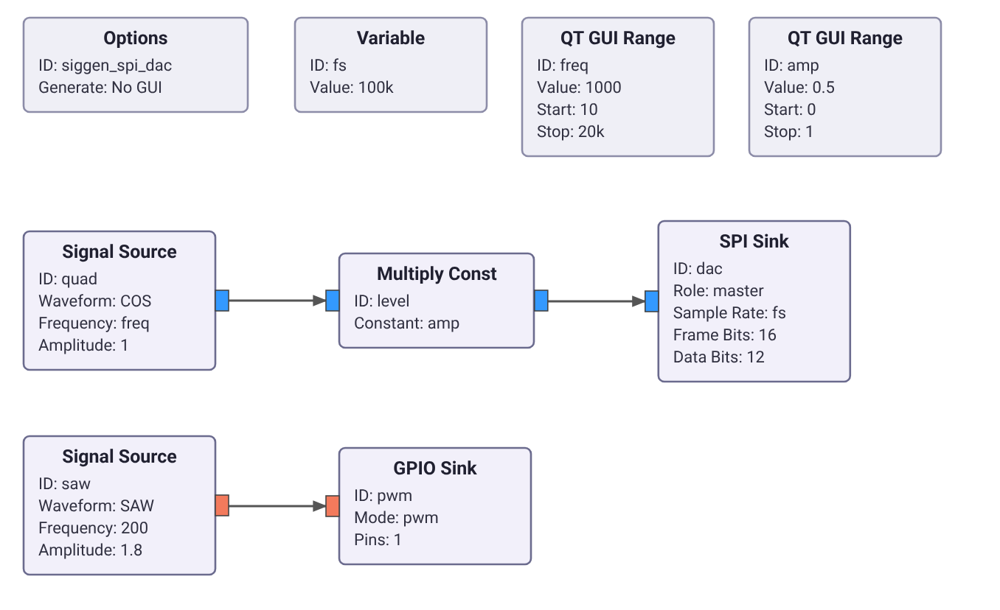

# Two-channel signal generator



A signal generator: a quadrature oscillator with runtime frequency and level drives a dual SPI DAC (sine and cosine on channels A and B) at 100 kS/s, and a sawtooth drives a PWM pin.

## Interfaces

| Interface | Kind | Format and rate | Pins or address |
|---|---|---|---|
| dac | SPI master output | cs12.11, 100 kS/s | `dac_sclk`, `dac_cs_n`, `dac_mosi` (registers at 0x6000) |
| pwm | GPIO output | s8.7 | `pwm_out` (registers at 0x6100) |

## Runtime parameters

| Variable | Range | Default | Register | Block |
|---|---|---|---|---|
| `amp` | 0 .. 1 | 0.5 | 0x0100 | level |
| `freq` | 10 .. 20000 | 1000 | 0x0104 | quad |

Write the hardware value of a parameter with the conversion function of the generated header (`siggen_spi_dac_top_<name>_hw()`), then set `CTRL.COMMIT`.

## Resources

grvgen estimate at 54 MHz: about 1728 LUT (1140 in the control plane), 5 multipliers (18x18), 2 block RAMs. The report in `generated/` lists every block, filter and stream.

## Build and simulate

```sh
python3 grvgen/grvgen.py examples/siggen_spi_dac/siggen_spi_dac.grc -o build/siggen_spi_dac
build/siggen_spi_dac/siggen_spi_dac_top_sim.sh -n 1500 --param freq=2500 --param amp=0.8
```

The testbench drives and checks the pins with models of the devices (converters, codecs, a UART line, a memory with random latency) and compares every output with the bit-exact graph model. `python3 tools/run_examples.py -k siggen_spi_dac` does both steps.

`generated/` holds the top level, the C header, the report and the pin constraint template as grvgen writes them.
