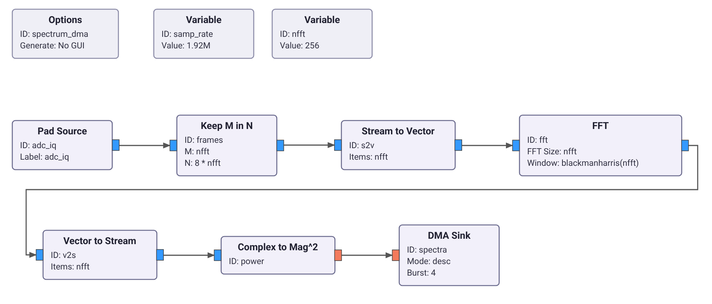

# Spectrum analyser with DMA



A 256-point spectrum analyser: one frame in eight of the ADC stream goes through a windowed FFT and a magnitude-squared stage, and a DMA channel writes the power spectra into a ring of buffers in RAM, one frame per buffer, without the CPU.

## Interfaces

| Interface | Kind | Format and rate | Pins or address |
|---|---|---|---|
| adc_iq | AXI4-Stream pad (in) | cs16.14, 1.92 MS/s | `adc_iq_tdata`, `_tvalid`, `_tready`, `_tlast` |
| spectra | DMA channel (S2MM, desc) | s16.-5 in 2-byte containers, 240 kS/s | `m_mem_*` (registers at 0x7000) |

## Resources

grvgen estimate at 54 MHz: about 2290 LUT (1370 in the control plane), 8 multipliers (18x18), 3 block RAMs. The report in `generated/` lists every block, filter and stream.

## Build and simulate

```sh
python3 grvgen/grvgen.py examples/spectrum_dma/spectrum_dma.grc -o build/spectrum_dma
build/spectrum_dma/spectrum_dma_top_sim.sh -n 6144
```

The testbench drives and checks the pins with models of the devices (converters, codecs, a UART line, a memory with random latency) and compares every output with the bit-exact graph model. `python3 tools/run_examples.py -k spectrum_dma` does both steps.

`generated/` holds the top level, the C header, the report as grvgen writes them.
