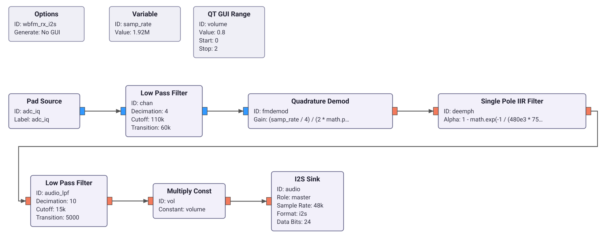

# Wideband FM receiver with I2S audio



A broadcast FM receiver built from primitive blocks: channel filter to 480 kS/s, quadrature demodulator, 75 us de-emphasis, audio filter and decimation to 48 kS/s, volume and an I2S DAC.

## Interfaces

| Interface | Kind | Format and rate | Pins or address |
|---|---|---|---|
| adc_iq | AXI4-Stream pad (in) | cs16.14, 1.92 MS/s | `adc_iq_tdata`, `_tvalid`, `_tready`, `_tlast` |
| audio | I2S output | s24.23, 48 kS/s | `audio_bclk`, `audio_ws`, `audio_sd` (registers at 0x6000) |

## Runtime parameters

| Variable | Range | Default | Register | Block |
|---|---|---|---|---|
| `volume` | 0 .. 2 | 0.8 | 0x0100 | vol |

Write the hardware value of a parameter with the conversion function of the generated header (`wbfm_rx_i2s_top_<name>_hw()`), then set `CTRL.COMMIT`.

## Resources

grvgen estimate at 54 MHz: about 3773 LUT (1120 in the control plane), 11 multipliers (18x18), 6 block RAMs. The report in `generated/` lists every block, filter and stream.

## Build and simulate

```sh
python3 grvgen/grvgen.py examples/wbfm_rx_i2s/wbfm_rx_i2s.grc -o build/wbfm_rx_i2s
build/wbfm_rx_i2s/wbfm_rx_i2s_top_sim.sh -n 24000
```

The testbench drives and checks the pins with models of the devices (converters, codecs, a UART line, a memory with random latency) and compares every output with the bit-exact graph model. `python3 tools/run_examples.py -k wbfm_rx_i2s` does both steps.

`generated/` holds the top level, the C header, the report and the pin constraint template as grvgen writes them.
